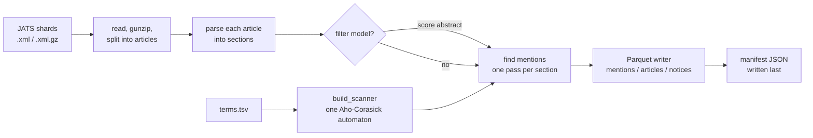

# How it works

## Why Aho-Corasick

The job is to find which of N terms (about 24 million for RNAcentral) appear in
each of M articles (millions). Running one search per term, the way LitScan 1
did, costs roughly N × corpus size.

An Aho-Corasick automaton is a trie of all the patterns, with "failure" links
that say where to jump when the next character doesn't continue the current
pattern. The text is read once, left to right. The automaton reports every
pattern that ends at each position, without backtracking. Scan time is linear in
the text length plus the number of matches, and doesn't depend on N. You pay for
N once, when building the automaton.

litscan-2 uses the [`aho-corasick`](https://docs.rs/aho-corasick) crate,
configured in `build_search_automaton` (`src/scanner.rs`):

| Setting | Value | Why |
|---|---|---|
| `match_kind` | `LeftmostLongest` | At any start position, prefer the longest term (`SSU rRNA gene` over `SSU rRNA`). |
| `ascii_case_insensitive` | `true` | `mir21`, `MIR21` and `miR21` all match. |
| `kind` | `ContiguousNFA` | Compact enough for tens of millions of patterns. |
| `start_kind` | `Both` | Allows anchored searches, used by the boundary retry [below](#word-boundaries). |

Measured on the full LitScan 1 vocabulary (23,887,833 terms): about 50 s to
build, with ~9 GB peak RSS (from the [LS1 comparison](ls1-comparison/README.md)).

## Building the automaton

`build_scanner(terms_path)` reads a UTF-8 file of `term_id<TAB>pattern` lines
with no header. A blank line is skipped. A line with no tab, a non-integer
`term_id` or an empty pattern is an error that reports the line number.

Each pattern becomes one or more automaton keys (`pattern_keys`):

- **ASCII patterns** (all 23.9M LitScan 1 terms) are lower-cased and used as-is.
- **Non-ASCII patterns** are NFC-normalised. Because the automaton only folds
  ASCII case, the lower-case and upper-case Unicode forms are added as extra
  keys, so `Δ-miR` also matches `δ-MIR`.

Keys are sorted before construction. This makes the automaton's pattern IDs
stable between runs, and that matters because `LeftmostLongest` breaks ties
between equal-length patterns by ID.

Different terms can end up as the same key, for example `MIR21` and `mir21`, or
`café` written precomposed and decomposed. The key then maps to every term ID,
and a hit is reported once for each of them. The `PatternIndex` counts these as
`n_shared_patterns` and prints a warning to stderr.

!!! warning "Patterns are normalised, article text is not"
    Patterns are NFC-normalised, but article text goes into the automaton
    unchanged. A non-ASCII pattern therefore misses text that encodes the same
    characters in decomposed form: the term `café RNA` doesn't match `cafe` +
    U+0301 in an article (checked with `scan_one`). This doesn't affect ASCII
    terms.

!!! question "Open question"
    How often do the Europe PMC shards contain decomposed (non-NFC) text?
    Should article text be NFC-normalised before scanning?

## Word boundaries

A raw match only counts if the character on each side isn't alphanumeric (Rust
`char::is_alphanumeric`, which covers all of Unicode). So `αMIR21` and
`MIR21α` don't match `MIR21`, but `α MIR21` does.

Rejecting a match can hide a real one. In "The number of SSU rRNA copies", with
the terms `er of SSU` and `SSU rRNA`, leftmost-longest finds `er of SSU` first
(it starts inside "number") and would skip past `SSU`. `boundary_matches`
handles this:

1. If the rejected match has a valid left boundary, retry at the same start
   with an **anchored** search limited to one character shorter. That finds the
   longest shorter pattern at that position. Repeat until one passes or none is
   left.
2. Otherwise, resume searching one character (not one byte) after the rejected
   start.

These cases are tested in `rejected_overlapping_match_does_not_hide_term`.

## From match to sentence

Each section's text is split into sentences with Unicode UAX #29 sentence
boundaries (`unicode-segmentation`). These are rule-based: `E. coli` can be
split after `E.`. The recorded sentence is the segment containing the start of
the match, extended to the segment containing its end. That way `symbol` always
lies inside `sentence`.

- `sentence_offset` counts **characters** (Unicode scalar values), not bytes,
  so `substr(sentence, offset + 1, char_length(symbol)) = symbol` holds in
  Postgres.
- Segments include their trailing whitespace, e.g. `'We saw MIR21 up-regulated. '`.
- Within an article, mentions are deduplicated to one per
  (section kind, symbol, sentence). Articles often repeat a sentence across
  several `other` sections or tables.

## What text is scanned

Each article is parsed (`parse_article_node`, `src/jats.rs`) into sections, and
every section is scanned:

| Section | Source |
|---|---|
| `title` | `<article-title>` |
| `abstract` | `<abstract>`. Structured abstracts are joined block by block, so headings don't run into the following text. |
| `introduction`, `methods`, `results`, `discussion`, `conclusion`, `supplementary`, `other` | Each **top-level** `<sec>` in `<body>`, including its titles and nested sections. |
| `other` | Body text outside any top-level `<sec>` |
| `figure` | Every `<fig>` label, caption title and caption text |
| `table` | Every `<table-wrap>` caption, footnotes and rows (one line per `<tr>`, cells joined with ` | `) |

Figures and tables come from anywhere in the article except `<sub-article>`.
Figure and table text is excluded from the body sections, so it isn't counted
twice.

A section's kind comes from its `sec-type` attribute (`SectionKind::classify`).
If that doesn't settle it, the title is checked for keywords such as
"introduction"/"background", "method"/"experimental", "result"/"findings",
"supplementary"/"appendix". Anything else is `other`.

Each article's front matter is also checked for retraction, correction and
expression-of-concern links. These go to `notices/` whether or not the article
mentions any term (see [Output files](outputs.md#notices)).

## Reading shards

A shard is a Europe PMC bulk open-access XML file, either gzipped or plain. Gzip
is detected from the file's first bytes, not its extension.

- **Splitting.** The shard is cut into individual `<article>` elements with a
  lightweight text scan (`split_articles`). Each article is then parsed as its
  own small document, in parallel, so no tree is ever built for a whole shard.
  If the shard has a `DOCTYPE`, the whole document is parsed at once instead,
  because per-article parsing would lose its entity definitions.
- **Encoding repair.** The bulk OA shards are double-encoded: UTF-8 bytes were
  read as Latin-1 and encoded again, so `Å` arrives as `Ã` + U+0085.
  `repair_double_utf8` (`src/lib.rs`) undoes this for each article. It leaves
  correctly encoded text alone. The [LS1 comparison](ls1-comparison/README.md#bug-found-and-fixed-during-validation)
  describes what this broke before it was fixed.

## Parallelism

`scan_shards` (`src/lib.rs`) runs three kinds of threads:

- **`n_decompress` shard workers** (default ⌈CPUs / 4⌉) each take the next
  shard, read it, gunzip it and hash it, then hand it to the scan pool.
- **One scan pool** with a thread per CPU parses and scans articles from every
  in-flight shard.
- **One writer thread per shard** receives record batches over a bounded
  channel and writes the Parquet files.

The scan pool always gets every core. `n_decompress` mainly limits memory: each
in-flight shard keeps its decompressed text in memory, about 1–1.5 GB. The GIL
is released for the whole scan.

Each shard's manifest is deleted at the start and written last, through an
atomic rename. A shard with a manifest is complete. One without a manifest was
interrupted, so scan it again: re-running overwrites its outputs.
